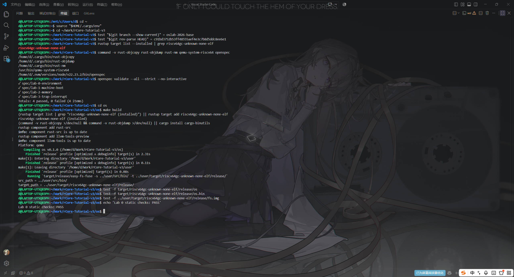
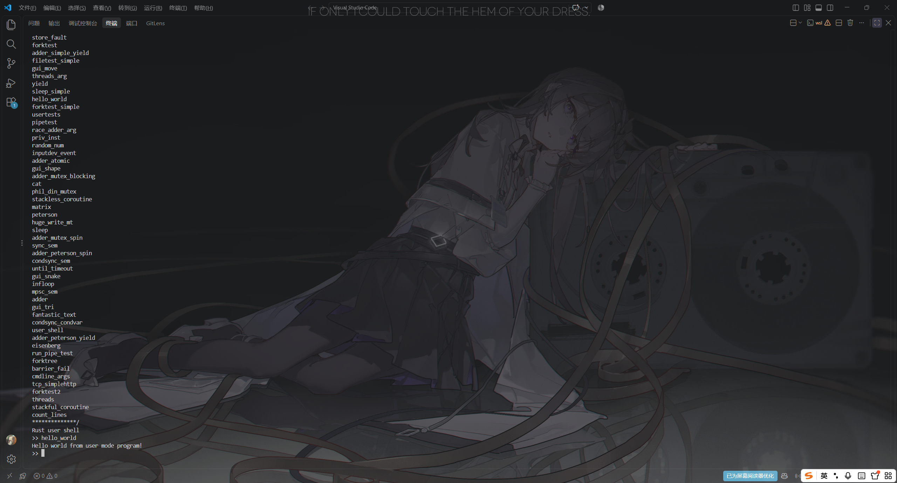

# 实验报告 Lab 0：课程导论与 rCore 编译

**实验环境**：WSL2（Ubuntu 24.04.3 LTS，代替课程默认的 VMware 虚拟机）· Rust 1.98.0 · `riscv64gc-unknown-none-elf` · QEMU 8.2.2 · OpenSpec 1.11.0

## 一、实验目的

搭好课程的完整工具链，锁定 rCore 源码基线，并打通「环境检查 → 读懂构建规则 → 交叉编译 → 检查 ELF → 启动 QEMU → 验证 OpenSpec」的闭环，为后续实验提供一个可复现的起点。

## 二、实验内容

1. **工具链**：用 rustup 安装课程固定版本 **1.98.0**，加装 `riscv64gc-unknown-none-elf` 目标与 `rust-src`、`llvm-tools`、`rustfmt`、`clippy` 组件。随后在仓库根目录执行 `rustup override set 1.98.0`——这一步不能省：rCore 自带的 `rust-toolchain.toml` 只写了 `channel = "stable"`，版本会随后续补丁更新漂移。
2. **源码基线**：克隆 rCore-Tutorial-v3，切到 `oslab-2026-base` 分支，HEAD 固定在课程规定的 `c91bd3752b53ff48555aef4e3c7b8d5ddc8ee6e1`。
3. **编译与 ELF 检查**：`cd os && make build`，再用 `file`、`rust-objdump -f -h` 核对目标架构、入口地址与段布局。
4. **首次启动**：`make run` 在 QEMU `virt` 上启动，确认 RustSBI 引导后进入 `Rust user shell`。
5. **OpenSpec**：`openspec init` 后安装四份规格，用 `validate --all --strict` 做严格校验。
6. **自动检查**：`check-env.sh` 逐项核对系统版本、外部命令、交叉目标、QEMU 主版本、Node、rCore 分支与 commit、内核 ELF 入口以及 OpenSpec 校验。

## 三、实验结果

```text
$ rust-objdump -f target/riscv64gc-unknown-none-elf/release/os
architecture: riscv64
start address: 0x0000000080200000
$ ls -l target/riscv64gc-unknown-none-elf/release/os.bin
-rwxr-xr-x 1 d d 229392 Oct 17 06:50 os.bin
$ make run
[rustsbi] RustSBI version 0.3.1, adapting to RISC-V SBI v1.0.0
...
Rust user shell
>> hello_world
Hello world from user mode program!
```

内核 `os` 是 RISC-V 64 位静态 ELF，入口与 `.text` 段都从 `0x80200000` 开始（`.text` 长 `0x2ca92`），扁平二进制 `os.bin` 为 229392 B；启动后打印 59 个用户程序清单并进入 shell，`hello_world` 输出正确；`openspec validate --all --strict` 得到 `4 passed, 0 failed`。

<!-- 截图 1：在 rCore 根目录执行 rustc --version、rustup show active-toolchain、rustup target list --installed、qemu-system-riscv64 --version、openspec validate --all --strict -->


**图 1**：工具链核对——`rustc 1.98.0`、`rustup show active-toolchain` 显示仓库根目录的 **1.98.0 目录 override**、RISC-V 目标已安装、QEMU 8.2.2，以及四份 OpenSpec 规格严格校验全部通过。

<!-- 截图 2：cd os && make run，在 Rust user shell 中输入 hello_world 的串口输出 -->


**图 2**：`make run` 的串口输出——RustSBI 引导后进入 `Rust user shell`，执行 `hello_world` 得到 `Hello world from user mode program!`。
