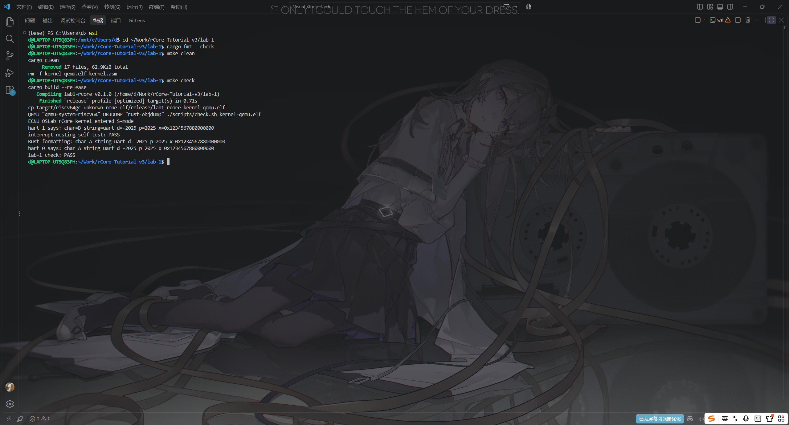
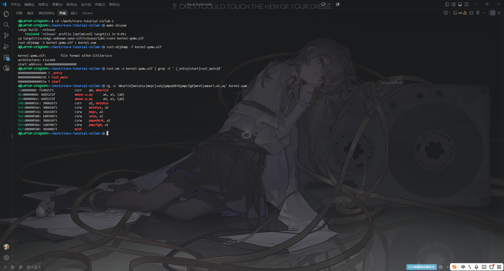

# 实验报告 Lab 1：机器启动与并发安全输出

**实验环境**：WSL2（Ubuntu 24.04.3 LTS）· Rust 1.98.0 · `riscv64gc-unknown-none-elf` · QEMU 8.2.2


## 一、实验目的

理解 RISC-V 从 M-mode 到 S-mode 的启动过程与双 hart 并发执行，完成 MMIO 串口驱动、关闭中断的自旋锁，以及「并发下整行输出不交错」的同步输出。

## 二、实验内容

按讲义在 `lab-1/` 完成起始工程的 8 处 `TODO`（`main.rs` 2 处、`uart.rs` 2 处、`sync.rs` 3 处、`console.rs` 1 处）：

- **入口与特权级切换**（`main.rs`）：`start` 先清 `mstatus.MPP` 再置 S 模式，写 `mepc = rust_main`、`satp = 0`（先关分页），PMP 全放行（`pmpaddr0` 取上限、`pmpcfg0` 取 `R|W|X|A_TOR`），把 hart ID 存入 `tp`，最后 `mret`（`options(noreturn)`）。
- **双 hart 同步**：只有 hart 0 初始化 UART，完成后用 `Release` 发布 `STARTED`，其余 hart 以 `Acquire` 自旋等待，避免「串口还没初始化就先打印」。
- **UART 与格式化输出**（`uart.rs`、`console.rs`）：按 IER → LCR 锁存 → DLL/DLM 设波特率 → LCR 设 8 位 → FCR 的顺序初始化；`putchar()` 先轮询 `LSR` 的 bit5 再写 `THR`；寄存器一律用 `read_volatile`/`write_volatile` 访问。
- **自旋锁**（`sync.rs`）：`push_off()` 先关本 hart 的 S-mode 中断并累加每 hart 的嵌套深度，`lock()` 用 `swap(true, Acquire)` 抢占；`Drop` 中先 `store(false, Release)` 再 `pop_off()`，只有深度回到 0 才重新开中断；`interrupt_nesting_selftest()` 自检两层嵌套不会提前开中断。
- **锁粒度**：`print()` 的 guard 覆盖整次 `write_fmt`，即一条完整消息，而不是单个字符——这是行内不交错的关键。

## 三、实验结果

```text
$ cd lab-1 && cargo fmt --check && make clean && make check
ECNU OSLab rCore kernel entered S-mode
hart 1 says: char=B string=uart d=-2025 p=2025 x=0x1234567880000000
interrupt nesting self-test: PASS
Rust formatting: char=A string=uart d=-2025 p=2025 x=0x1234567880000000
hart 0 says: char=A string=uart d=-2025 p=2025 x=0x1234567880000000
lab-1 check: PASS
```

`d=-2025`、`p=2025`、`x=0x1234567880000000` 分别验证了有符号十进制、无前缀十六进制与 64 位整数没有被截断；两个 hart 的消息各出现一次且行内无交错（先后顺序可变，验收脚本只要求这些行都出现）。

静态证据：符号表 `_entry` 位于 `0x80000000`，`rust_main` 为 `0x80000236`，`start` 为 `0x8000055a`；反汇编中 `mret` 1 条、`csrw pmpaddr0` 与 `csrw pmpcfg0` 各 1 条、`csrr mhartid` 1 条，另有 2 条 `amoor.w.aq`，即编译器为 `AtomicBool::swap` 生成的原子加锁指令。

<!-- 截图 1：cd lab-1 && cargo fmt --check && make clean && make check 的完整输出 -->


**图 1**：`make clean && make check` 的输出——五条规定输出齐全、`interrupt nesting self-test: PASS`，末行 `lab-1 check: PASS`、退出码 0。

<!-- 截图 2：cd lab-1 后执行 rust-objdump -f kernel-qemu.elf、rust-nm -n kernel-qemu.elf | grep _entry/rust_main/start、make disasm 后 rg 'mhartid|mstatus|mepc|satp|pmpaddr0|pmpcfg0|mret|amoor\.w\.aq' kernel.asm -->


**图 2**：静态证据——入口 `_entry` 在 `0x80000000`，反汇编可见 `csrr mhartid`、`csrw mstatus/mepc/satp/pmpaddr0/pmpcfg0` 与 `mret`，以及 `AtomicBool::swap` 生成的 `amoor.w.aq`。
