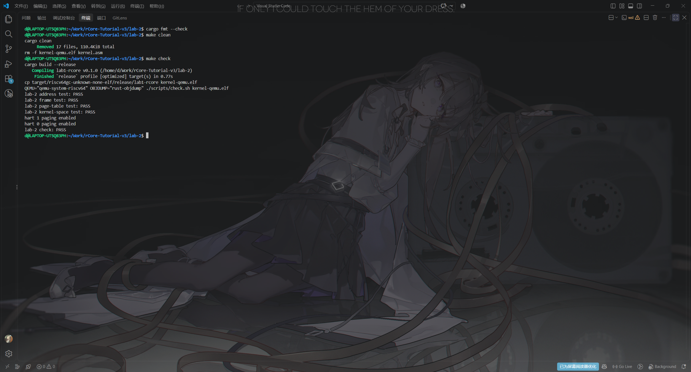
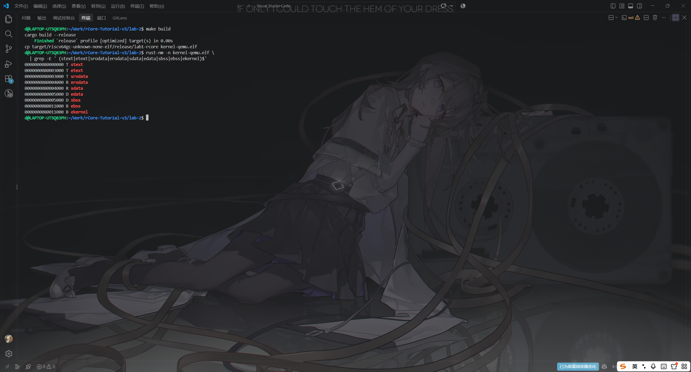

# 实验报告 Lab 2：物理内存与内核虚拟内存

**实验环境**：WSL2（Ubuntu 24.04.3 LTS）· Rust 1.98.0 · `riscv64gc-unknown-none-elf` · QEMU 8.2.2

## 一、实验目的

实现物理页帧分配器与 Sv39 三级页表，把内核各段按最小权限恒等映射进内核地址空间，并在打开分页（写 `satp`）之后保持内核输出正常、两个 hart 行为一致。

## 二、实验内容

在 Lab 1 工程上覆盖 `src/mm/` 骨架，完成 8 处 `TODO`：

- **地址表示**（`mm/address.rs`）：物理/虚拟地址的 floor、ceil 页对齐，`page_offset()` 取低 12 位，`indexes()` 从后向前写入，得到页表遍历顺序 `[VPN2, VPN1, VPN0]`。
- **页帧分配**（`mm/frame_allocator.rs`）：原子锁保护的头插空闲链表；`frame_alloc()` 先取出后继再解锁，最后把整页 4096 字节清零；`FrameTracker::drop` 断言页对齐与范围、遍历链表查重后才回收；另有带越界与成环检测的 `free_frame_count()` 用于自检。
- **页表**（`mm/page_table.rs`）：`PageTable` 用固定大小数组持有全部页表页；`find_pte_create_ptr()` 事务性地创建中间级页表，失败时清父 PTE 并回退计数与页帧；`map()` 拒绝 W-only 与重复映射，`translate()` 只查询、绝不分配。
- **内核地址空间**（`mm/memory_set.rs`）：断言 9 个链接边界符号的顺序与页对齐；分段权限为 `.text` `R|X`、`.rodata` `R`、`.data`/`.bss` 及其余内核部分 `R|W`、UART 一页 `R|W`，全部不含 U；`verify_kernel_mapping()` 遍历全部映射检查 W^X，通过后才令 `token = (SV39 << 60) | root_ppn`。
- **启用分页**（`arch.rs`、`main.rs`）：新增 `activate_page_table()` 执行 `csrw satp` + `sfence.vma`；hart 0 完成自检后发布 token，两个 hart 都等到 token 非零才开分页并各自打印 `hart N paging enabled`。

## 三、实验结果

```text
$ cd lab-2 && cargo fmt --check && make clean && make check
lab-2 address test: PASS
lab-2 frame test: PASS
lab-2 page-table test: PASS
lab-2 kernel-space test: PASS
hart 1 paging enabled
hart 0 paging enabled
lab-2 check: PASS
```

四项自检分别独立输出、不用 `&&` 短路，任一项失败都只打印结果并停在 `wfi`，不会带着错误的页表去开分页。分页确实生效：反汇编中 `8000117a: csrw satp, a0` 紧跟 `80001180: sfence.vma`（两个 hart 各自执行一次），另有 M-mode `start` 中的 `80001596: csrw satp, a1`（先把 `satp` 归零再交给 S-mode）。

<!-- 截图 1：cd lab-2 && cargo fmt --check && make clean && make check 的输出 -->


**图 1**：`make clean && make check` 的输出——address / frame / page-table / kernel-space 四项自检 PASS、两个 hart 的 `paging enabled`，末行 `lab-2 check: PASS`。

<!-- 截图 2：cd lab-2 后执行 rust-nm -n kernel-qemu.elf | grep -E 'stext|etext|srodata|erodata|sdata|edata|sbss|ebss|ekernel'，以及 make disasm 后 rg 'csrw satp|sfence\.vma' kernel.asm -->


**图 2**：内核段布局与分页启用证据——链接边界符号 `stext`/`etext`/`srodata`/`erodata`/`sdata`/`edata`/`sbss`/`ebss`/`ekernel` 依次为 `0x80000000`、`0x80003000`、`0x80003000`、`0x80004000`、`0x80004000`、`0x80005000`、`0x80005000`、`0x80011000`、`0x80011000`，均为 4 KiB 对齐；反汇编中可见 `csrw satp` 与 `sfence.vma`。
