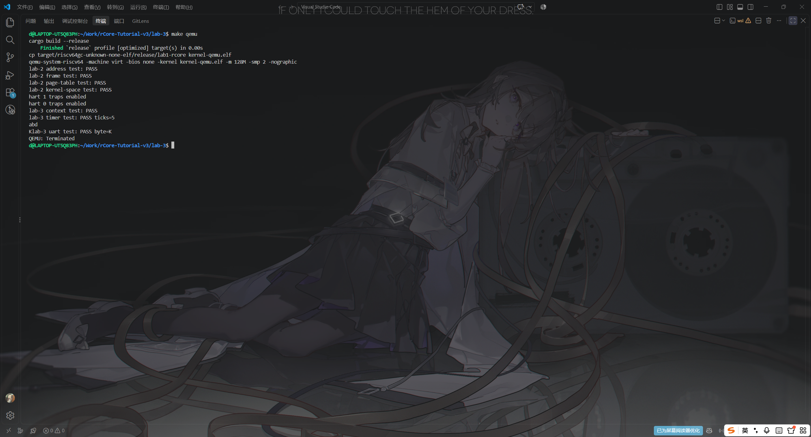

# 实验报告 Lab 3：中断与异常初步

**实验环境**：WSL2（Ubuntu 24.04.3 LTS）· Rust 1.98.0 · `riscv64gc-unknown-none-elf` · QEMU 8.2.2

## 一、实验目的

建立 S-mode 的 trap 入口与异常/中断委托，接通 PLIC 外部中断（串口输入回显）与 CLINT 时钟中断两条路径，并保证在分页与中断都已开启的情况下内核输出依然正确。

## 二、实验内容

在 Lab 2 工程上覆盖 trap、PLIC、时钟三个骨架，完成 9 处 `TODO`（`plic.rs` 4 处、`timer.rs` 2 处、`trap.rs` 3 处），并改动 `arch.rs`、`main.rs`、`uart.rs`、`console.rs`、`mm/memory_set.rs`：

- **委托与入口**：M-mode `start` 在 `mret` 前写 `medeleg = 0xffff`、`mideleg` 只放开 bit 1/5/9（SSIE/STIE/SEIE）；`stvec` 用 Direct 模式指向 `kernel_vector`，`trap.S` 用 `.align 4` 保证四字节对齐。`#[repr(C)] KernelTrapContext { x: [usize; 32] }` 共 256 字节，与 `trap.S` 的 `8*n` 偏移逐一对应，最后由 `sret` 返回。
- **PLIC**：三页寄存器区（priority `0x0c00_0000`、hart 0 的 S 使能 `0x0c00_2000`、claim/threshold `0x0c20_1000`）在开分页前恒等映射；为串口 IRQ 10 设置优先级、使能与阈值；处理时先 `claim()` 取中断号，处理完对每个非零中断号 `complete()`。
- **串口中断**：`IER` 打开接收中断；`receive_byte()` 先查 `LSR` 位 0 再读 RHR；中断中循环读到 FIFO 空，并处理退格与回车。
- **时钟中断**：`timer::init_machine()` 用 `mscratch` 指向的五字 scratch（每个 hart 一份）保存现场与 `mtimecmp`、间隔，`mtvec → timer_vector`，再开 `mstatus.MIE` 与 `mie.MTIE`；`timer_vector` 续约 `mtimecmp` 并置 `sip.SSIP`；S 侧对 `scause = 1` 递增 `TICKS`（仅 hart 0）后清 SSIP。`INTERVAL = 1_000_000`，约为 0.1 s 一次。
- **初始化顺序**：`init_hart()` 先设 `stvec`，再 `plic::init_hart()`，最后才开 `sstatus.SIE`；hart 0 完成全局初始化后以 `Release` 发布，hart 1 以 `Acquire` 等待后再各自初始化。

## 三、实验结果

```text
$ cd lab-3 && cargo fmt --check && make clean && make check
lab-2 address test: PASS
lab-2 frame test: PASS
lab-2 page-table test: PASS
lab-2 kernel-space test: PASS
hart 1 traps enabled
hart 0 traps enabled
lab-3 context test: PASS
lab-3 timer test: PASS ticks=5
Klab-3 uart test: PASS byte=K
lab-3 check: PASS
```

前四行是 Lab 2 的内存与分页自检，加入 trap、PLIC 与时钟代码后依然全部 PASS，说明中断改造没有破坏内存管理；`ticks=5` 表示时钟中断连续触发了 5 次，`K` 是检查脚本注入的字符被内核回显的结果。

静态证据：`kernel_vector` 位于 `0x80000030`、`timer_vector` 位于 `0x800000d0`；全镜像只有 1 条 `sret`（trap 返回）和 2 条 `mret`（`start` 与 `timer_vector`），`csrw stvec`、`csrw mtvec`、`csrw mscratch` 各 1 条，`csrs sip` 与 `csrc sip` 各 1 条（置位与清除 SSIP）。

<!-- 截图 1：cd lab-3 && cargo fmt --check && make clean && make check 的输出 -->


**图 1**：`make clean && make check` 的输出——两个 hart 的 `traps enabled`、context / timer / uart 三条自检 PASS，末行 `lab-3 check: PASS`。

<!-- 截图 2：串口交互（输入普通字符、退格、回车、K 的完整回显），或 make disasm 后 rg 'csrw stvec|csrw mtvec|csrs sip|csrc sip|sret' kernel.asm -->


**图 2**：串口交互与 trap 现场——输入 `abc` 后退格再输入 `d`、回车与 `K` 的实际回显顺序。
