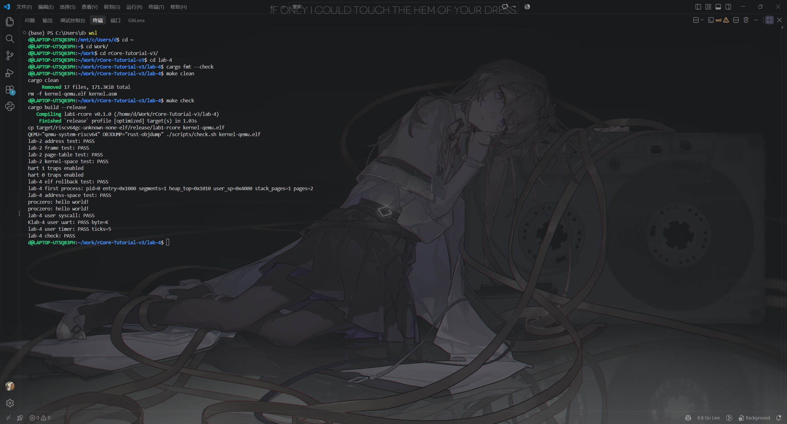
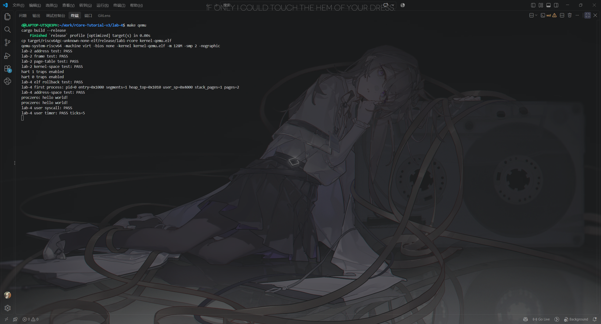

# 实验报告 Lab 4：首个用户进程

**实验环境**：WSL2（Ubuntu 24.04.3 LTS）· Rust 1.98.0 · `riscv64gc-unknown-none-elf` · QEMU 8.2.2（`-smp 2`）

## 一、实验目的

在 Lab 3 的分页与中断之上装载首个 RISC-V ELF 用户程序：建立只含用户所需页面的独立 Sv39 页表，区分内核调度用的 TaskContext 与用户返回用的 TrapContext，经 trampoline 的 `sret` 进入 U-mode，并在用户态完成 ecall、时钟与 UART 中断的往返。

## 二、实验内容

在 Lab 3 工程上覆盖 starter，完成 `process.rs`、`trap_user.rs`、`trap_user.S`、`task_context.rs`、`user_image.rs` 5 个骨架文件的 9 处 `TODO`，接入给定的 `switch.S`，并改动 `main.rs`、`mm/memory_set.rs`、`arch.rs`、`sync.rs`、`uart.rs`、`trap.rs` 等。

- **ELF 校验与装载**：实现越界安全的 `read_u8/16/32/64` 与格式检查（魔数、ELF64、小端、RISC-V、`ET_EXEC`、范围、`filesz ≤ memsz`、入口在可执行段、拒绝重叠与 W|X）；按 `PT_LOAD` 逐页申请 `FrameTracker`、按 `p_flags|U` 建立页表、只复制 `filesz` 字节，其余由分配器清零。出错时返回错误字符串并由 `Drop` 归还已申请页帧。
- **用户地址空间**：`from_elf` 建立独立页表，把 `user_vector` 页按 R|X 映射到 `TRAMPOLINE`（0x7fff_f000），按 `p_vaddr` 装载代码页，在 `heap_top=0x1010` 之后留一页无 PTE 的 guard page，再映射一页 R|W|U 用户栈（`sp=0x4000`，16 字节对齐），把 `TRAP_CONTEXT`（0x7fff_e000）映射为 R|W 且无 U/X，并申请一页内核栈。用户页表只有 trampoline、代码、栈、context 四个叶子页；内核页表经 `kernel_map` 把 trampoline 与同一 context 页映射到相同地址，使切换 `satp` 后 handler 仍能访问现场。`layout_check` 逐页核对权限、guard 为空、UART/PLIC 不可见。
- **两种上下文**：`TaskContext { ra, sp, s[12] }` 共 112 字节，`goto_trap_return` 把 `ra` 置为 `trap_return`、`sp` 置为内核栈顶，启动时以清零上下文为 `current` 调用 `__switch`；`UserTrapContext` 固定 37 个机器字，初始化 `sepc=0x1000`、`x[2]=0x4000`、清 `SPP`、置 `SPIE`、清 `SIE`，其字段偏移由 `size_of`/`offset_of` 对照 `trap_user.S` 自检。
- **trap 往返**：`user_vector` 保存 x1、x3、x4、x5～x31、用户 sp、`sstatus` 和 `sepc` 后切到内核页表与内核栈；`user_restore` 切回用户 satp、重设 `sscratch`、恢复全部寄存器并 `sret`；`trap_return` 先设 `stvec=TRAMPOLINE`，再跳到 `TRAMPOLINE + (user_restore - user_vector)`，保证切换页表后的取指仍落在两个页表共有的 trampoline 页内。自旋锁的 `pop_off` 改为恢复进入前的 SIE，避免 handler 内的 `println!` 重新开中断后以 trampoline 为入口重入。
- **syscall 与设备中断**：`scause=8` 先 `sepc += 4`，`a7=1` 时打印 hello 并回写 `a0=0`，第二次输出 syscall PASS；`scause=1` 调用 Lab 3 的 tick 更新并清 SSIP，第 5 次输出 timer PASS；`scause=9` 经 PLIC claim、排空 UART FIFO、再 complete，收到 `K` 时输出 uart PASS；未知 trap 打印 scause/sepc/stval 后停机。

## 三、实验结果

```text
$ cd lab-4 && cargo fmt --check && make clean && make check
lab-4 elf rollback test: PASS
lab-4 first process: pid=0 entry=0x1000 segments=1 heap_top=0x1010 user_sp=0x4000 stack_pages=1 pages=2
lab-4 address-space test: PASS
proczero: hello world!
proczero: hello world!
lab-4 user syscall: PASS
Klab-4 user uart: PASS byte=K
lab-4 user timer: PASS ticks=5
lab-4 check: PASS
```

用户程序从 0x1000 进入 U-mode：两次 `ecall` 输出两行 hello 与 syscall PASS；第 5 次用户态时钟中断输出 timer PASS；注入 `K` 后由用户态外部中断回显该字符并输出 uart PASS。静态证据：`user_vector` 位于 0x80001000（页对齐），`user_restore` 位于 0x80001066，二者同页；trampoline 内含 `csrw satp`、`sfence.vma` 与 `sret`。



**图 1**：`make clean && make check` 的完整输出——ELF 回滚、地址空间、hello、syscall/timer/uart 全部 PASS，末行 `lab-4 check: PASS`。



**图 2**：用户程序在 U-mode 的运行输出与串口回显——两次 hello、syscall/timer/uart 自检 PASS，以及注入字符 `K` 的实际回显。
