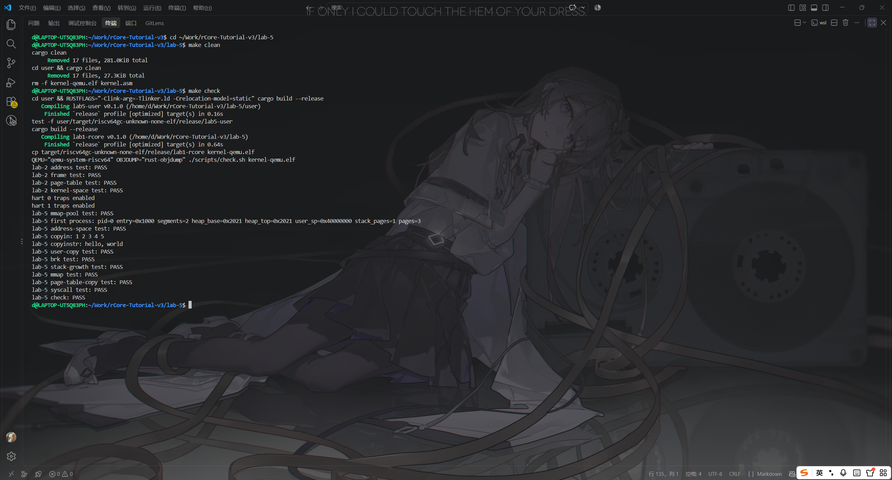
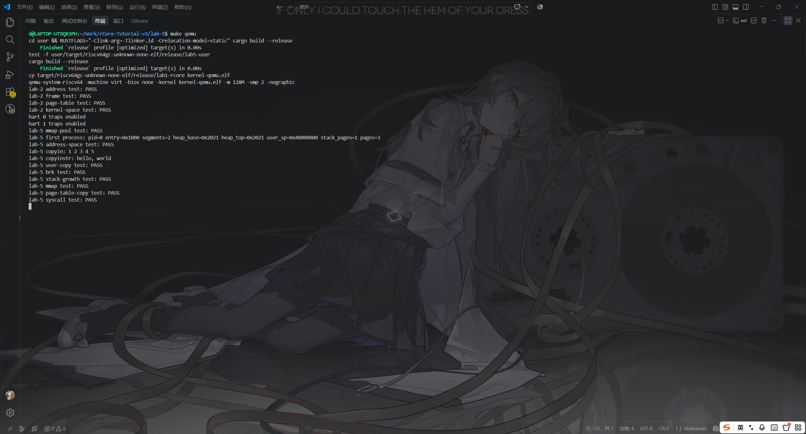

# 实验报告 Lab 5：系统调用与用户虚拟内存

**实验环境**：WSL2（Ubuntu 24.04.3 LTS）· Rust 1.98.0 · `riscv64gc-unknown-none-elf` · QEMU 8.2.2（`-smp 2`）

## 一、实验目的

在 Lab 4 的首个用户进程上实现安全的系统调用 ABI 与用户虚拟内存管理：用户数据复制、`brk` 堆、缺页驱动的栈增长、`mmap/munmap`，以及用户地址空间的深复制与销毁。所有用户地址、长度、系统调用号和页表权限都按不可信输入处理。

## 二、实验内容

- **系统调用 ABI**：U-mode 用 `a7` 传系统调用号、`a0～a5` 传参数；`user_vector` 保存 37 字现场并切换到内核页表与内核栈，`dispatch` 读取参数、把返回值写回 `a0`，未知编号返回 -1。`trap_return` 经 trampoline 的 `sret` 返回用户态，`sepc` 只在 `ecall` 时前进 4 字节。
- **用户数据复制**：`copyin/copyout/copyinstr` 先用 `checked_add` 检查地址范围，再按当前用户页表逐页验证 `U|R` 或 `U|W`，按页内剩余长度分段复制。这样跨页缓冲区即使对应不连续的物理页也能保持顺序；非法地址和只读代码页不会产生部分写入。
- **堆与栈**：`brk` 在 ELF 数据末端与 `MMAP_BEGIN` 之间调整堆顶；增长时逐页申请、清零并建立 `U|R|W` 映射，任一步失败都回滚全部新页并保持原 `heap_top`。用户栈固定在 `0x4000_0000`，避开 9 页堆增长；load/store page fault 在低于当前栈底、不低于 `MMAP_END`、不超过 16 页且不与已有映射重叠时，按页向低地址扩展。处理完不增加 `sepc`，由 `sret` 重试原指令。
- **mmap/munmap**：256 个 region 节点组成固定仓库，用 `SpinLock` 保护，两个 hart 并发各申请一半、屏障同步后释放并核对归属。`mmap` 支持自动选址和固定地址，长度向上取整，插入后与前后相邻区间合并；`munmap` 覆盖完整删除、前缀、后缀和中间拆分四种情况，先验证 PTE 与帧所有权，再释放目标物理页。
- **地址空间复制与销毁**：遍历用户页表叶子，除共享只读 trampoline 外，每个私有页申请新帧并复制 4 KiB，trap context 也作为私有页复制；同时深复制 mmap region 链表。失败路径由局部 `FrameTracker` 和 `Drop` 完整回收。销毁副本后，空闲帧数和空闲节点数恢复到复制前。
- **资源准备**：进程内核栈改为 32 KiB 静态数组，`entry.S` 中每个 hart 的启动栈改为 32 KiB，帧所有权表扩大到 384 项，防止跨页复制和页表复制时溢出。

## 三、实验结果

`make clean && make check` 在双 hart QEMU 上完整通过：

```text
lab-5 mmap-pool test: PASS
lab-5 address-space test: PASS
lab-5 copyin: 1 2 3 4 5
lab-5 copyinstr: hello, world
lab-5 user-copy test: PASS
lab-5 brk test: PASS
lab-5 stack-growth test: PASS
lab-5 mmap test: PASS
lab-5 page-table-copy test: PASS
lab-5 syscall test: PASS
lab-5 check: PASS
```

静态检查：用户 ELF 为 64 位 RISC-V，入口 `0x1000`；`user_vector` 在 `0x80001000`、`user_restore` 在 `0x80001066`，两者同页且页内包含 `sret` 与 `sfence.vma`；`cargo fmt --check` 和 OpenSpec strict 校验均通过。



**图 1**：`make clean && make check` 的完整输出，末行 `lab-5 check: PASS`。



**图 2**：`make qemu` 下用户程序依次完成复制、brk、栈增长和 mmap/munmap 测试。

## 四、问题与总结

WSL2 下没有 VMware，直接以 `qemu-system-riscv64 -smp 2` 作为虚拟机；双 hart 的节点仓库自检和时钟中断都需要显式同步。最初沿用 Lab 4 把用户栈放在 `0x4000`，9 页 `brk` 增长会与栈相撞，改为 `0x4000_0000` 后堆、mmap 与栈互不干扰。调试时通过逐页 PTE 检查和帧计数，发现并修正了复制接口按字节而用户测试按 `u32` 读取的问题。最终实现把用户地址视为不可信输入，错误路径不 panic、不产生部分副作用。
